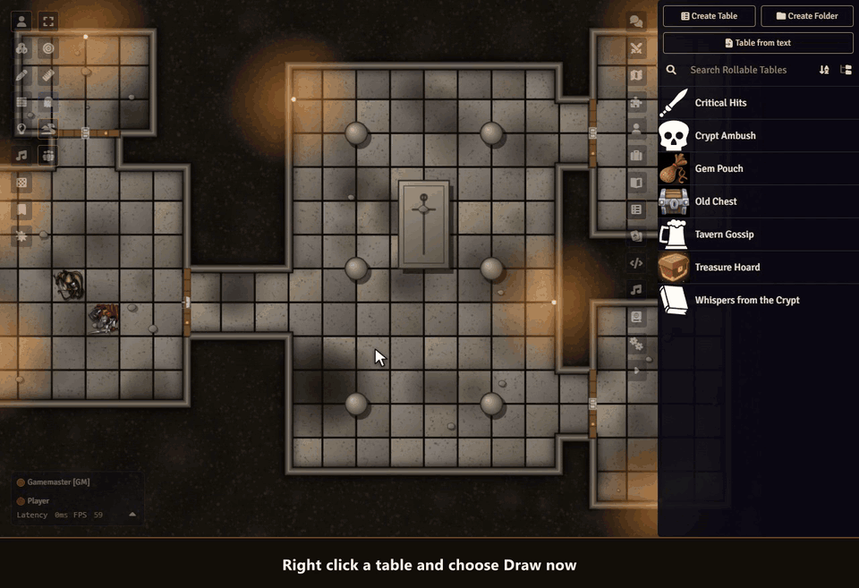

# Sephral’s Deep Tables

**You roll on the treasure table and get "a chest". So you roll on the chest table, then on the gem table, then for how many gems, and you write it all down for the players. Deep Tables does it in one go: tables inside tables, quantities like 2d4+1 and one clear card, and a click puts the result where it belongs.**

[](#install)
[](https://discord.gg/7BjCgDYaBP)
[](https://github.com/Sephral)



## Highlights

* **Table library:** 36 ready tables for names, inns, rumors, travel, weather, encounters and loot, in English and German. Preview, then import a group.
* **Rows with conditions:** a row only comes up at night, in the right scene or Region, for the right level or when a story tag is on. The deep roll window says why a row was left out.
* **Results that act:** a result can place a saved group of monsters, put tokens on the map, play a sound, show a handout or run a macro, with undo.
* **Tables with a memory:** a table remembers what it gave, even after a restart.
* **Tables for your players:** release a table and they roll it from their chat.
* **A natural 20 that rolls a table:** with Roll Triggers by Sephral, a critical hit table rolls by itself.
* **Deep roll:** look at the result before anybody sees it. Untick rows, change a quantity, draw one row again.
* **Tables inside tables:** a result that points to another table is rolled on, as often as its quantity says.
* **Quantities and draws:** formulas like 2d4+1, several draws, no duplicates, and dice or tables rolled right inside a sentence.
* **One clear card:** a click gives it to a character, a loot pile or the Loot Ledger.
* **Table from text:** paste a list and get a roll table.

## How it works

1. Right click a roll table and choose *Deep roll* or *Draw now*.
2. Change what you like, then click *Show in chat*.
3. On the card click *Place*, *Give to character* or whatever the result offers.

## Good to know

Saved Encounters and Roll Triggers by Sephral add encounter placing and triggers. The rest works without them. Only the GM runs actions.

## Install

Deep Tables is not in Foundry's module search. Copy this link:

```text
https://github.com/Sephral/sephrals-deep-tables/releases/latest/download/module.json
```

1. In Foundry's setup screen open **Add-on Modules** and click **Install Module**.
2. Paste the link into **Manifest URL** at the bottom of the window.
3. Click **Install**, then enable the module in your world.

On The Forge open the Bazaar, click **Install From Manifest** and paste the link.


Foundry VTT 13 and 14 · any game system · English and German

## Learn more

Every button, setting and the macro API are explained in the [manual](MANUAL.md). Questions or ideas? Join us on [Discord](https://discord.gg/7BjCgDYaBP). Looking for more? See [all modules by Sephral](https://github.com/Sephral).

## License

See [LICENSE.md](LICENSE.md).
